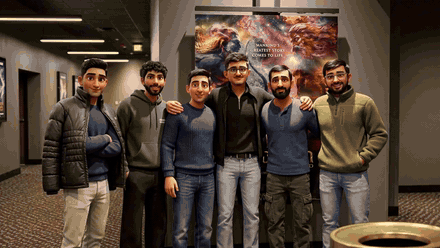
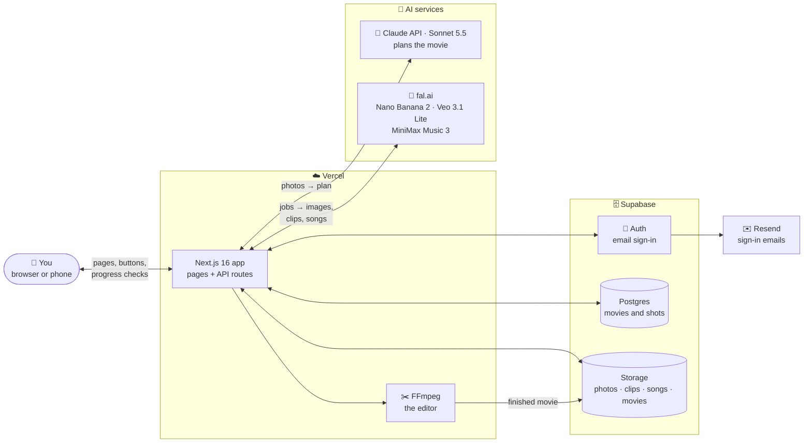
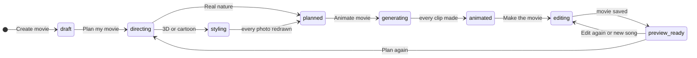
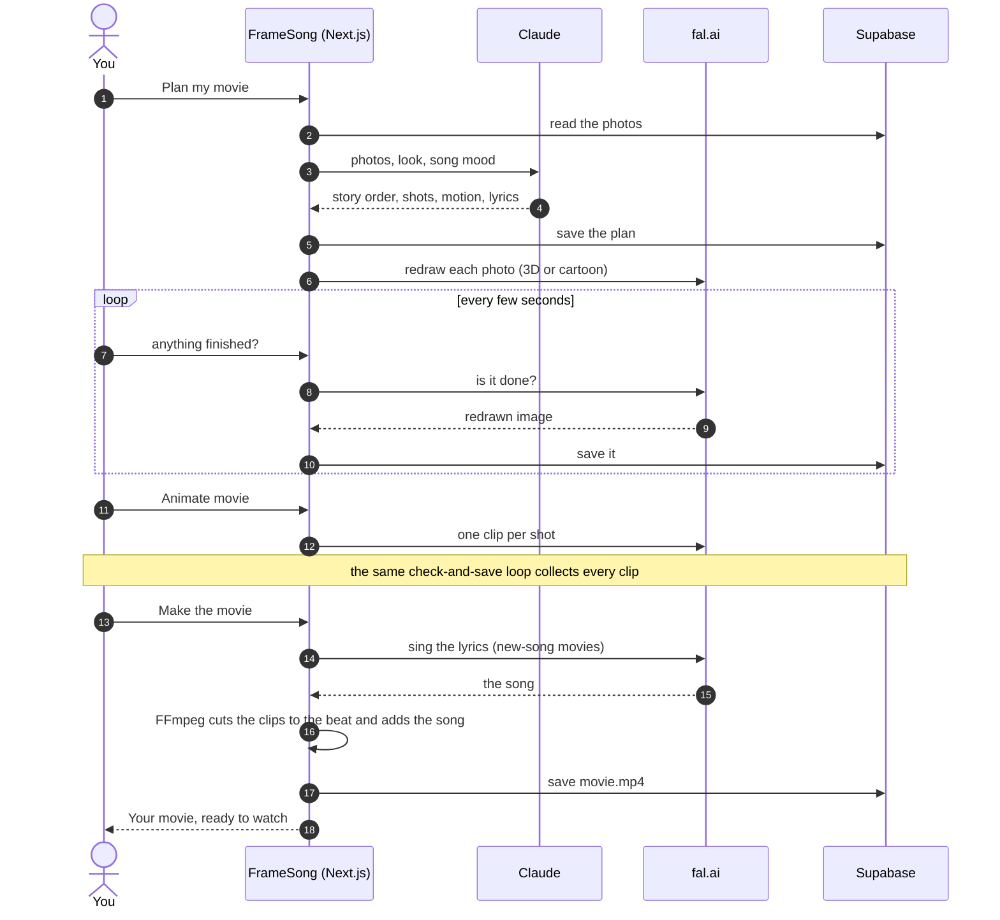

<p align="center">
  
</p>

<p align="center">
  
  
  
  
  
  
</p>

<p align="center">
  <b>Drop in a few photos. Pick a look. Get back a short film, animated shot by shot and cut to its own song.</b>
</p>

---

## 🍿 See it

<p align="center">
  
</p>

<p align="center"><sub><b>"Room"</b>: 5 photos → 3D animated look → 5 animated clips → one 24-second movie set to the creator's own song. Shown at 2× speed.</sub></p>

---

## ⚡ How it works in 30 seconds

1. **📸 You add photos** and choose a look: *Real nature*, *3D animated*, or *Cartoon*.
2. **🎬 Claude directs.** It looks at every photo, puts them in story order, plans how each shot moves, and writes song lyrics.
3. **🎨 The photos are redrawn** in your chosen look (3D and cartoon only).
4. **🎞️ Every shot comes to life** as a short video clip.
5. **🎵 A song is made** from Claude's lyrics, or your own song is used.
6. **✂️ The clips are cut to the beat** and joined with the song.
7. **🍿 You watch and download** the finished movie.

<p align="center">
  
</p>

### The pipeline, step by step

| Step | What happens | Powered by | Time | Cost |
|:--|:--|:--|:--|:--|
| 📸 **Upload** | You add 3 to 20 photos and pick a look, a song (a mood for a new song, or your own file), and a format: widescreen, vertical, or square. Photos are shrunk in the browser, then saved privately. | Next.js + Supabase Storage | seconds | free |
| 🎬 **Plan** | Claude studies every photo, chooses the story order, writes a camera move for each shot, decides how long each shot plays, and writes original lyrics with a tempo. | Claude Sonnet 5.5 (Claude API) | about 1 min | a few cents |
| 🎨 **Redraw** | Each photo is redrawn as a 3D animated film frame or a hand-drawn cartoon, keeping the same people and places. Real nature movies skip this step. | Nano Banana 2 on fal.ai | about 1 min | ~$0.08 per photo |
| 🎞️ **Animate** | Each shot becomes a 4, 6, or 8-second clip that follows Claude's camera move. Clips are made a little longer than needed, so the edit can cut them on the beat. | Veo 3.1 Lite on fal.ai (720p, silent) | 1 to 3 min | ~$0.03 per second |
| 🎵 **Song** | A singer performs Claude's lyrics at the planned tempo. Movies with your own song skip this. | MiniMax Music 3 on fal.ai | about 1 min | ~$0.002 per second |
| ✂️ **Edit** | Every clip is trimmed so cuts land on the beat, cropped to fill the movie's format, and joined in order, with the song underneath and a fade at the end. | FFmpeg on our own server | about 1 min | free |
| 🍿 **Movie** | One MP4 file to watch on the page or download. | Supabase Storage | — | — |
| 🔭 **4K** | The finished movie is upscaled for a sharp 4K download. | *Coming in Day 5* | | |

---

## 🏗️ Architecture

FrameSong is one Next.js app. The pages run in your browser; the API routes run on Vercel's servers, which are the only place the secret keys live. Supabase holds the accounts, the data, and every file. The heavy AI work happens on Claude and fal.ai, and the final edit runs with FFmpeg right inside the app.



**Four ideas hold it together:**

- **⏳ Slow jobs never freeze the page.** When you start a step, the app hands the work to fal.ai and returns right away. The page then checks in every few seconds, and each check collects whatever finished and saves it to storage. That's why you can leave during redrawing or animating and come back later.
- **🔒 Everyone sees only their own movies.** Supabase row level security checks every database read and write, and files live in a private bucket under `<user id>/<movie id>/`, so one account can never open another's photos.
- **🗝️ Secret keys stay on the server.** `ANTHROPIC_API_KEY` and `FAL_KEY` are only read inside API routes. The browser only ever gets Supabase's publishable key.
- **💸 You see the cost before you spend.** Every paid step shows an estimate and asks before it starts.

### 🎞️ A movie's life

Every movie moves through these statuses. The badge on each movie page shows where it is.



<details>
<summary><b>🔬 Under the hood: one full run, message by message</b></summary>
<br>



</details>

---

## 💰 What a movie costs

Example: a 5-photo movie in the 3D animated look, about 25 seconds long.

| Step | Cost |
|:--|--:|
| 🎬 Plan with Claude | ~$0.03 |
| 🎨 Redraw 5 photos | ~$0.40 |
| 🎞️ Animate 5 clips (6 seconds each) | ~$0.90 |
| 🎵 New song (skip with your own song) | ~$0.06 |
| ✂️ Edit | free |
| **Total** | **about $1.40** |

Real nature movies skip the redraws, so they cost about a third less.

---

## 🗺️ Build log

| Day | What it adds | |
|:--|:--|:--:|
| 1 | Website, email sign-in, photo uploads, GitHub and Vercel | ✅ |
| 2 | 🎬 Claude plans the story and song; photos redrawn in 3D or cartoon | ✅ |
| 3 | 🎞️ Every shot animated into a clip | ✅ |
| 4 | 🎵 The song and the edit: one finished movie | ✅ |
| 5 | 🔭 4K upscale, movie gallery | ⏳ |
| 6 | 📱 Polish, phone layout, retries, spending limit | ⏳ |
| 7 | 🚀 Real-world testing and launch | ⏳ |

---

## 🧰 Swap any model

Each AI step is one line of code, so you can trade quality for price.

| Step | Change this | And update the cost estimate in |
|:--|:--|:--|
| Plan | `DIRECTOR_MODEL` in `lib/director.ts` | — |
| Redraw | `RESTYLE_MODEL` and `RESTYLE_RESOLUTION` in `lib/restyle.ts` | — |
| Animate | `VIDEO_MODEL` and `VIDEO_RESOLUTION` in `lib/animate.ts` | `VIDEO_PRICE_PER_SECOND` in `lib/video.ts` |
| Song | `SONG_MODEL` in `lib/edit.ts` | `SONG_PRICE_PER_SECOND` in `lib/timeline.ts` |

---

<details>
<summary><b>🚀 Run it yourself</b></summary>
<br>

**You'll need:** Node.js 22 or newer, Git, and free accounts at Supabase, Vercel, GitHub, the Claude Console (platform.claude.com), fal.ai, and Resend.

**1. Install**

```bash
npm install
```

If npm asks you to approve install scripts, approve FFmpeg's (it downloads the FFmpeg program the edit uses):

```bash
npm install-scripts approve ffmpeg-static
```

**2. Set up Supabase**

- Create a project, open the **SQL Editor**, and run `supabase/schema.sql`. On a project made before Day 4, run `supabase/day2.sql`, `day3.sql`, and `day4.sql` instead, in that order.
- **Authentication → URL Configuration:** set the Site URL to your live address, and add `http://localhost:3000/**` and `https://your-site.vercel.app/**` to the Redirect URLs.
- **Authentication → Emails → SMTP Settings:** connect Resend (host `smtp.resend.com`, port `465`, username `resend`, your Resend API key as the password). Supabase's built-in sender only allows a few emails an hour.

**3. Add your keys** to a file named `.env.local`:

```bash
NEXT_PUBLIC_SUPABASE_URL=https://your-project.supabase.co
NEXT_PUBLIC_SUPABASE_PUBLISHABLE_KEY=sb_publishable_...
ANTHROPIC_API_KEY=sk-ant-...
FAL_KEY=...
```

`.env.local` is listed in `.gitignore`, so your keys never reach GitHub.

**4. Run it**

```bash
npm run dev
```

Open http://localhost:3000, sign in with the email link, and make a movie.

**5. Put it online:** push to GitHub, import the repository in Vercel, add the same four keys under **Environment Variables**, and deploy. Every `git push` to `main` updates the live site.

</details>

<details>
<summary><b>📁 Project map</b></summary>
<br>

```
app/
  page.tsx                          Home page
  login/page.tsx                    Sign in with an email link
  auth/                             Finishes sign-in, signs out
  studio/page.tsx                   Your movies
  studio/new/page.tsx               New movie builder
  studio/[id]/page.tsx              One movie: shots, clips, song, finished movie
  api/movies/[id]/plan              🎬 Claude plans the movie, then redraws start
  api/movies/[id]/progress          🎨 Collects finished redraws
  api/movies/[id]/restyle           🎨 Retries failed redraws
  api/movies/[id]/animate           🎞️ Starts a clip for every shot
  api/movies/[id]/clips             🎞️ Collects finished clips
  api/movies/[id]/edit              🎵 Starts the song and the edit
  api/movies/[id]/edit-progress     ✂️ Follows the song, runs FFmpeg, saves the movie
components/
  NewMovieForm.tsx                  Photos, look, song, and format
  MoviePlanner.tsx                  The "Make the movie" panel and its progress
lib/
  director.ts                       Talks to Claude and checks its plan
  restyle.ts                        Redraws on fal.ai
  animate.ts, video.ts              Clips on fal.ai, clip lengths, cost estimate
  edit.ts                           The song on fal.ai
  timeline.ts                       Cuts on the beat, fitting cuts to the song
  render.ts                         The final edit with FFmpeg
  supabase/                         Browser, server, and session helpers
supabase/
  schema.sql                        Everything, for a new project
  day2.sql, day3.sql, day4.sql      Updates for older projects
docs/readme/                        The images in this README
```

</details>

<details>
<summary><b>🩹 If something goes wrong</b></summary>
<br>

| You see | What to do |
|:--|:--|
| "Too many sign-in emails were sent" | Connect Resend in Supabase's SMTP settings (step 2). |
| "That sign-in link didn't work" | Request a new link and open the newest email in the same browser. |
| "ANTHROPIC_API_KEY is missing" or "FAL_KEY is missing" | Add the key to `.env.local`, then restart `npm run dev`. On Vercel, add it under Environment Variables. |
| A database error mentioning a column or "check constraint" | Run the matching `supabase/dayN.sql` file. |
| Shots say "Not redrawn" or "Not animated" | Select **Redraw** or **Try again**. Models sometimes refuse a picture, often a safety filter on faces. |
| "FFmpeg isn't installed" | Run `npm install` (and approve `ffmpeg-static` if npm asks), then restart. |
| "The finished movie is bigger than 50 MB" | That's Supabase's free storage limit per file. Try fewer shots. |
| The edit stops on the live site | Keep the movie page open while it says **Editing**. |

</details>

---

<p align="center"><sub>Built one day at a time with Next.js, Supabase, Vercel, Claude, and fal.ai.</sub></p>
